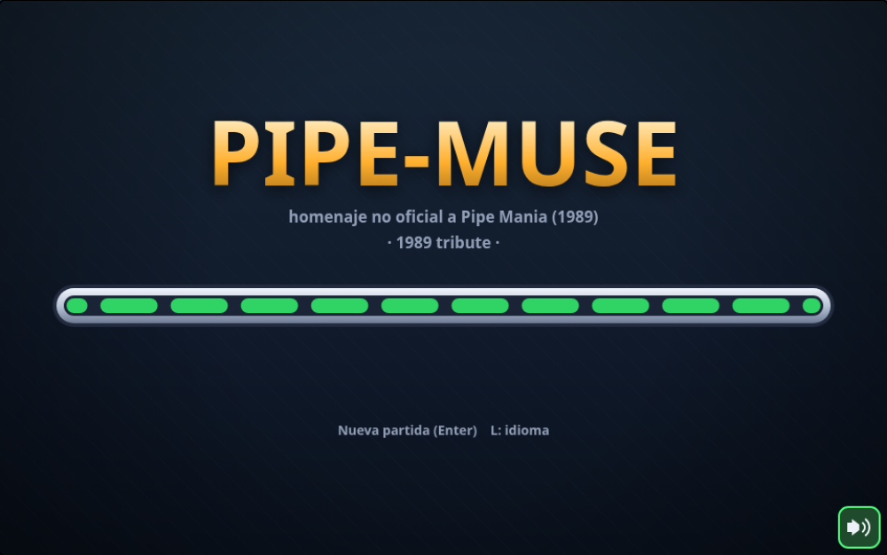
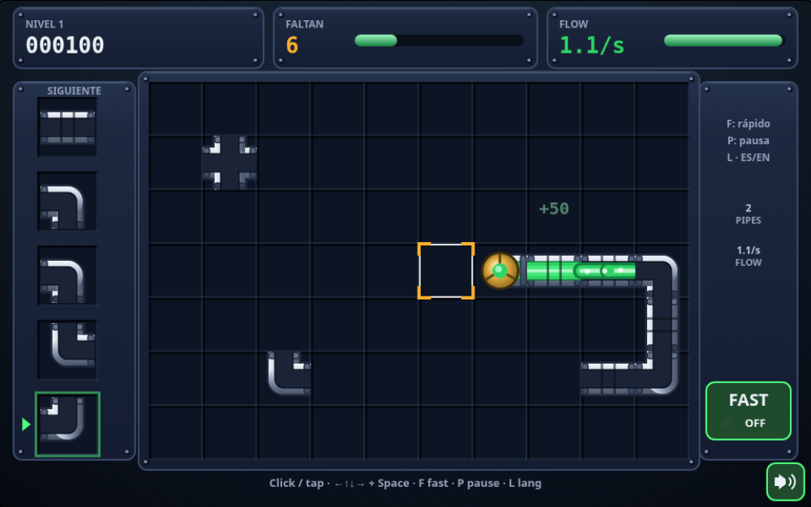
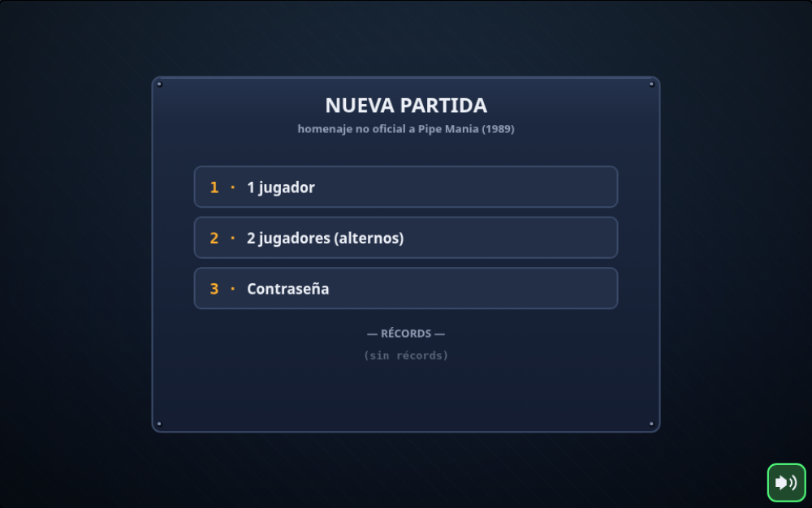

# pipe-muse

**[Español](#español) · [English](#english)**



> **Nota / Note:** `pipe-muse` es un homenaje no oficial a *Pipe Mania* (*Pipe Dream*, 1989).
> Todos los gráficos, sonidos y música son originales. / An unofficial tribute to
> *Pipe Mania* (*Pipe Dream*, 1989). All graphics, sounds and music are original.

---

## Español

Juego para navegador inspirado en las mecánicas de Pipe Mania (1989);
grafismo, sonido y código originales, con estética HD propia.



### Cómo jugar

Construye una tubería desde la válvula de salida antes de que llegue el
*flujo* y recorre la distancia mínima sin derrames.

- **Colocar:** clic/toque o flechas + Espacio/Enter. Siempre se coloca la
  pieza inferior del dispensador.
- **Reemplazar:** colocar sobre una tubería aún vacía la destruye (−50, breve
  bloqueo). Las llenas no se pueden tocar.
- **Rápido:** F o botón FAST (×2 puntos mientras dure).
- **Pausa:** P o Esc. **Sonido:** M o botón 🔊. **Idioma:** L (ES/EN).

Elementos por niveles: obstáculos, pieza final (+500), tuberías
unidireccionales, depósitos (lentos, +300), bordes conectados, ronda bonus
cada 4 niveles (puntos ×2) y contraseñas cada 4 niveles. 1–2 jugadores
alternos y tabla de récords local.



### Compilar y jugar

```sh
npm install
npm run dev        # desarrollo → http://127.0.0.1:5173/
npm test           # tests unitarios (Vitest)
npm run build      # sitio estático en dist/ (listo para GitHub Pages)
npm run build:demo # demo monofichero en demo/ (la usa el portfolio)
npm run preview    # sirve dist/ en local
```

Sin dependencias en runtime: HTML5 Canvas + TypeScript + Vite. Toda la
configuración del juego (tiempos, velocidades, distancias, puntos) vive en
`src/config.ts`.

---

## English

A browser game inspired by the mechanics of Pipe Mania (1989); original
graphics, sound and code, with its own HD look.

### How to play

Build a pipeline from the start valve before the *flujo* arrives, and cover
the minimum distance without spilling.

- **Place:** click/tap or arrows + Space/Enter. The bottom dispenser piece is
  always the one placed.
- **Replace:** placing over an unfilled pipe destroys it (−50, brief lockout).
  Filled pipes are locked.
- **Fast:** F or the FAST button (×2 points while active).
- **Pause:** P or Esc. **Sound:** M or the 🔊 button. **Language:** L (ES/EN).

Level features: obstacles, end piece (+500), one-way pipes, reservoirs (slow,
+300), wrap-around edges, bonus round every 4 levels (×2 points) and passwords
every 4 levels. 1–2 alternating players and a local records table.

### Build & run

```sh
npm install
npm run dev      # dev server → http://127.0.0.1:5173/
npm test         # unit tests (Vitest)
npm run build    # static site in dist/ (ready for GitHub Pages)
npm run preview  # serves dist/ locally
```

No runtime dependencies: HTML5 Canvas + TypeScript + Vite. All game tuning
(timings, speeds, distances, scoring) lives in `src/config.ts`.

---

## Estructura / Structure

```text
src/
  main.ts        boot + fixed-timestep loop + HiDPI scaling
  config.ts      ALL game constants (single tuning file)
  i18n.ts        ES/EN strings
  core/          pure logic: pieces, board, flow, scoring, levels, password
  game/          Game state machine + records (localStorage)
  render/        HD procedural Canvas art (no assets)
  audio/         Web Audio SFX + original chiptune
  input/         mouse/touch/keyboard
tests/           Vitest suite (core + game + audio events)
screenshots/     README captures (not shipped to dist/)
```
